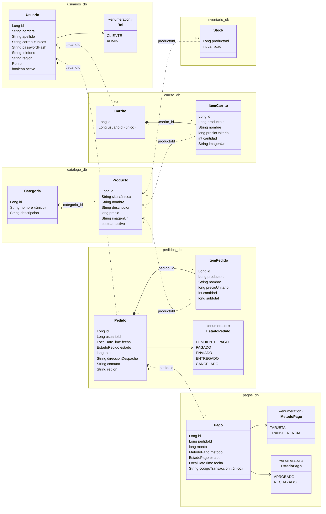

# Modelo de datos de ArtCrate

Una base de datos MySQL por servicio. Las líneas sólidas son claves foráneas reales (dentro de una misma base);
las punteadas son referencias por id entre servicios (sin clave foránea, porque cada servicio tiene su propia base).

